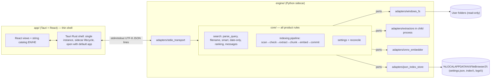
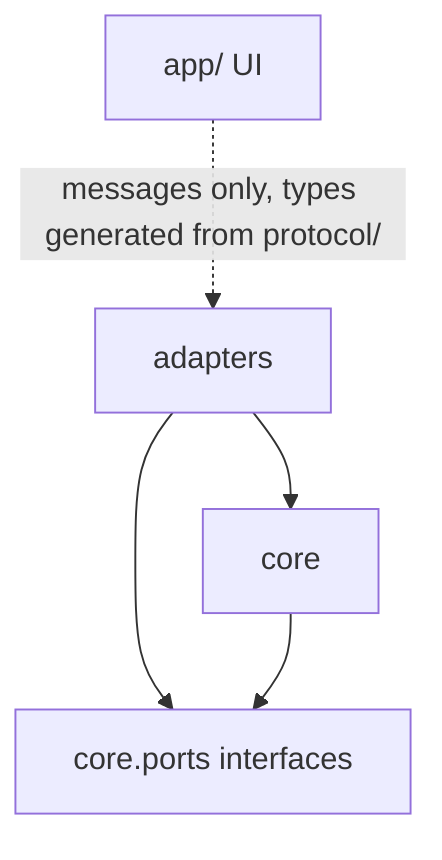
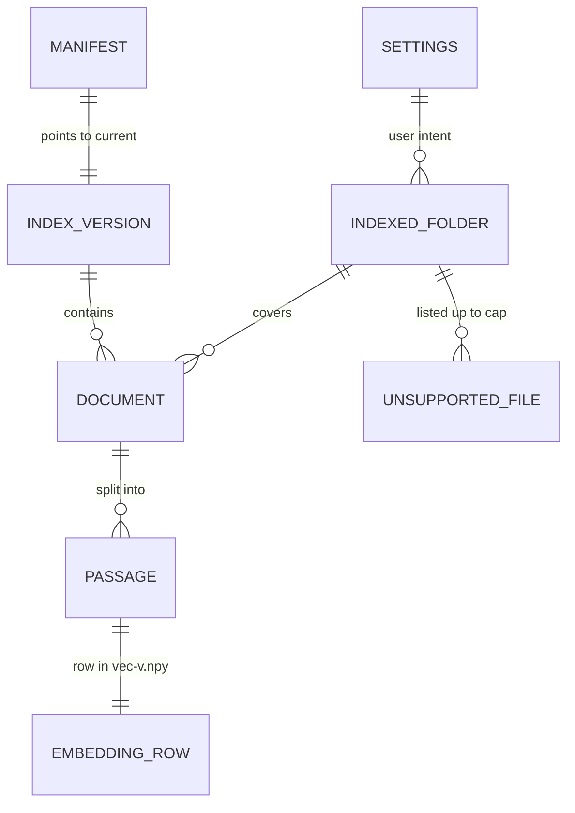
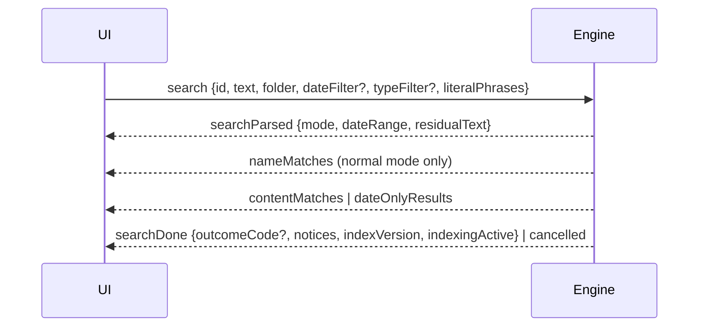
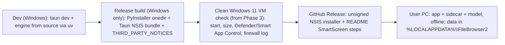

# Architecture Spine — File Browser 2.0

Settled upstream and binding here: the PRD's fixed stack (C-5), no database of any kind (C-1), offline only (C-2), exactly one embedding model and no generative model (C-3), read-only on user files (C-4, NFR-8), simplicity first (C-6), public repository with synthetic fixtures only (C-7).

## Design Paradigm

Two processes on one Windows 11 PC. The **UI shell** (Tauri + React) renders and forwards. The **engine** (Python sidecar) owns every product rule, organised as **hexagonal / ports and adapters**: a pure `core` with ports, and `adapters` that implement them against the outside world. Indexing is a **pipes-and-filters** pipeline inside the core, using the same ports.



Dependency direction (a rule, see AD-1):



## Invariants & Rules

### AD-1 — Hexagonal engine core; indexing as a pipeline [ADOPTED]

- **Binds:** all FRs; `engine/`
- **Prevents:** product rules leaking into storage, extraction or UI code; tests that need real files or a loaded model.
- **Rule:** All product rules (Date Phrases FR-14, date-only detection FR-23, Filters FR-15, ranking FR-16, Close Match and Relevance Floor FR-17, choice of user message and notice, skip reasons and their display groups FR-8/FR-11) live in `engine/core`. `core` imports nothing from `engine/adapters`, the file system, ONNX Runtime or JSON storage directly; it talks to the world only through interfaces in `engine/core/ports` (FileSystemPort, ExtractorPort, EmbedderPort, IndexStorePort, SettingsPort). Indexing is the stage sequence scan → check → extract → chunk → embed → commit; a stage that cannot process a file records a `ReadOutcome` and passes it on, it never stops the pipeline.

### AD-2 — Sidecar transport: stdin/stdout UTF-8 JSON lines [ADOPTED]

- **Binds:** all FRs; NFR-1, NFR-9, NFR-10; `app/`, `engine/adapters/stdio_transport`, `protocol/`
- **Prevents:** two incompatible channels; corrupted or mis-encoded lines (Hebrew); replies matched to the wrong request; any network-looking traffic.
- **Rule:** The engine runs as a Tauri sidecar child process and communicates only over its stdin/stdout, one UTF-8 JSON object per line, flushed per line. The engine forces UTF-8 on stdin/stdout at start, reserves the real stdout for protocol lines only (redirects `sys.stdout` and fd 1 to the log), and writes all protocol output through one writer queue on one thread. Every request carries a unique `id`; every reply, progress or error for it echoes that `id`; unsolicited events use `id: null`. A message larger than the line limit in `protocol/` is sent as several replies on the same `id`. Message types are defined once as JSON Schemas in `protocol/` (see conventions). No TCP/HTTP listener exists in either process.

### AD-3 — Thin UI: the engine decides, the UI words [ADOPTED]

- **Binds:** FR-12..FR-18, FR-22, FR-23; `app/`
- **Prevents:** the same rule implemented in TypeScript and Python and drifting; English sentences inside the Hebrew UI; two string catalogs.
- **Rule:** The UI contains no product rule: no date parsing, filtering, ranking, threshold, grouping or "which message/notice" logic. The engine never sends user-visible sentences; it sends message **codes** with data (for example `{"code":"noMatchesInRange","from":"2025-10-01","to":"2025-10-31"}`), and lists the notices to show (for example `indexingInProgress`, `cantFindExplanation`) in the reply. All user-visible strings, in English and Hebrew, live in one catalog in `app/` (FR-18), which also owns date and number formatting for display.

### AD-4 — One path to user files: the engine's FileSystemPort [ADOPTED]

- **Binds:** FR-1..FR-6, FR-8, FR-22, indexing; NFR-8
- **Prevents:** permission (FR-4) and OneDrive (FR-8) rules implemented twice; three walkers that disagree on which files exist; a hung extraction blocking everything; "Show in folder" built two different ways.
- **Rule:** Listing folders, Filename Search, reading for preview and reading for indexing all go through FileSystemPort, which exposes one `list()` and one `walk()`; the core owns one `is_candidate(entry)` predicate (skips hidden/system items, Office lock files `~$*`, and junction/symlink loops) used by all three. The adapter reads attributes from directory enumeration and never opens a file with `RECALL_ON_DATA_ACCESS` set, nor descends into a directory with `RECALL_ON_OPEN` set. ExtractorPort is `extract(path, max_chars | None)`; every extraction has a size cap and a wall-clock timeout from `engine/core/rules/` (outcomes `tooLarge`, `cannotRead`); indexing and preview call the same port with different limits. "Show in folder" (FR-3) is **in-app** navigation to the parent folder with the file selected. The only OS call the UI shell makes directly is "open with the default app" (FR-3). No component ever writes, moves or deletes a user file.

### AD-5 — Single writer, versioned snapshots, command semantics [ADOPTED]

- **Binds:** FR-7, FR-9, FR-10, FR-11, FR-13, FR-20, FR-21, FR-23; NFR-8
- **Prevents:** concurrent-write corruption; a removed folder reappearing; readers seeing half-written data; builders disagreeing on what Remove, cancel or a nested folder means.
- **Rule:** Only the indexing pipeline writes the Index. Add folder, remove folder, check for new documents, rebuild and delete are **commands**: the engine records the user's intent in `settings.json` (AD-13) and acknowledges, then the pipeline acts. Remove preempts: the pipeline stops its current batch, commits the removal next, and until then readers exclude documents outside the current folder set. Commands are not affected by `cancel`, which applies to user requests only. A document stays in the Index while any Indexed Folder covers it; adding a nested folder is a no-op. An unreachable Indexed Folder (unplugged drive) keeps its entries and is reported as a status code. Readers see only committed versions; the writer hands each new committed snapshot to readers in-process.

### AD-6 — Index on disk: derived data, manifest-switched versions [ADOPTED]

- **Binds:** FR-9, FR-10, FR-11, FR-20, FR-21; NFR-4, NFR-8, NFR-9; C-1
- **Prevents:** a crash or power loss leaving a mixed or unreadable Index; incompatible embeddings, chunking or prefixes mixed after a change; endless re-embedding because change detection never matches; a whole Search folders section without data.
- **Rule:** The Index lives only in `%LOCALAPPDATA%\FileBrowser2\index\` as plain files: `manifest.json` (current version, index format version, model id, model file SHA-256, embedding dimension, pooling, query and passage prefixes, max tokens, chunking parameters), `meta-<v>.json` and `vec-<v>.npy` (float32, row order defined by meta). Per document, meta stores the identity key, display path, `mtime_ns`, size (the FR-10 change key), Activity Date source, Passages and any `ReadOutcome`; per Indexed Folder it stores unsupported files as `{path, ext}` up to a cap in `rules/` plus totals. A commit writes temp files, flushes and `fsync`s them, renames them into place with `os.replace`, then replaces `manifest.json` the same way, retrying on Windows sharing errors. Commits happen at most every N documents or T seconds (values in `rules/`). `.npy` files are loaded fully, never memory-mapped, always with `allow_pickle=False`. On start the engine deletes temp files and versions the manifest does not name, tolerating locked files; an unreadable meta or vec is quarantined and triggers a rebuild, never a crash. Any manifest field that differs from the shipped engine (including a newer format) means the old version is never loaded: the engine serves an empty Index plus whatever the rebuild commits, with `indexingActive` set (FR-20). Every update re-checks skipped files and recounts unsupported files, not only changed ones. The Index is derived data: it is always reconciled against `settings.json` and never holds user intent. No database, SQL or vector store is used (C-1).

### AD-7 — In-memory serving: date first, then meaning; documents, not Passages [ADOPTED]

- **Binds:** FR-12..FR-17, FR-23; NFR-2, NFR-6
- **Prevents:** per-search disk reads missing the 2 s / 6 s targets; a persisted date list drifting; meaning scored over documents a filter will discard; caps and thresholds applied to Passages in one story and to files in another.
- **Rule:** The engine holds the current committed snapshot in memory and builds, in memory only, a list of documents sorted by local Activity Date, rebuilt on every snapshot switch and never persisted. Date-only search (FR-23) is a range slice of that list with no embedder call; its members are all documents in the Index for the range, including those with a `ReadOutcome` (they can be opened, not previewed as text). Any search with a Date or Type Filter selects in-range Passages first and scores only those. Scoring is brute force (no approximate index, C-6). A document's score is its best Passage's score; the Relevance Floor, the Close Match threshold, the top-20 cap and the 5-Close-Match cap all apply to documents. A Type Filter also hides folders from Name matches.

### AD-8 — One embedding model behind EmbedderPort, ONNX on CPU [ADOPTED]

- **Binds:** FR-9, FR-13; NFR-2, NFR-4, NFR-6, NFR-7, NFR-12; C-3
- **Prevents:** comparing embeddings from different models; double or missing prefixes; thresholds meaningless after a model swap; PyTorch or a generative model in the installer; two model copies in memory.
- **Rule:** Exactly one embedding model ships, called only through EmbedderPort `embed_query(text)` and `embed_passages(texts)`. The adapter owns tokenization, prefixes and pooling and returns L2-normalized float32; score = dot product. It runs on ONNX Runtime (CPU) with `tokenizers` and NumPy only: no PyTorch, `transformers`, `sentence-transformers` or `optimum` in the shipped engine, and no generative model. One shared ONNX session serves indexing and queries. Primary model `ibm-granite/granite-embedding-97m-multilingual-r2`, fallback `intfloat/multilingual-e5-small`; the SM-1 bake-off in Phases 3–4 (fp32 and int8 builds, measured on an AVX2-only CPU) picks one under C-3's give-way order, then it is frozen. Tuning values in `rules/` are keyed by model id. Any change to the model, its file, prefixes, pooling or max tokens forces a rebuild (AD-6).

### AD-9 — Dates, time zone and document identity [ADOPTED]

- **Binds:** FR-10, FR-14, FR-15, FR-23; protocol
- **Prevents:** every file looking modified on every start; a document saved late on Saturday falling into the wrong week; duplicate entries for one file; lower-cased names in the UI.
- **Rule:** The change key is `mtime_ns` + size. Activity Date is derived from `mtime_ns` and converted to a local calendar date when the in-memory date list is built, using the current time-zone rules. Every date range (Date Phrases, presets, FR-23) is computed by the engine in local time as inclusive calendar days, weeks Sunday to Saturday (FR-14). ISO 8601 is the protocol form for dates. A document's identity key is `casefold(NFC(normpath(full long path)))`, computed inside the core and never sent; the protocol carries the original-case display path. Paths arriving from the UI are normalized by the engine. A rename is a remove plus an add (FR-10).

### AD-10 — Concurrency inside the engine [ADOPTED]

- **Binds:** FR-6, FR-9, FR-13, FR-22, FR-23; NFR-2, NFR-3, NFR-4, NFR-6
- **Prevents:** searches and previews stuck behind indexing or the GIL; stale results overwriting newer ones; a held arrow key queuing dozens of previews; double model memory.
- **Rule:** One engine process holds one long-lived indexing worker (the only writer, AD-5) and a small pool for user requests. CPU-heavy text extraction for indexing runs in one child process owned by the indexing worker (extraction only, never Index writes). The indexing worker caps ONNX intra-op threads at cores − 1 and yields between files. User requests never wait for the indexing worker. Latest-wins applies **per channel** (`search`, `preview`, `listFolder`): a new request on a channel cancels the running one on that channel only. Every long operation checks its cancel token between files or directories.

### AD-11 — Privacy and safety guardrails in every adapter [ADOPTED]

- **Binds:** NFR-1, NFR-8, NFR-9, NFR-10; C-2, C-4, C-7; FR-21
- **Prevents:** a well-meaning adapter adding a download, telemetry or update check; a user's document text in a log; uninstall leaving data behind or deleting too much.
- **Rule:** No adapter or UI code opens a network connection, downloads a file or checks for updates. Logs are local only, in `%LOCALAPPDATA%\FileBrowser2\logs\`, size-capped and rotated, and contain paths and error codes but never document text, Passages or search queries. Errors cross the protocol as codes (AD-3); stack traces never reach the UI. Repository fixtures are synthetic or freely licensed (C-7). The uninstaller's "delete data" option removes the whole `%LOCALAPPDATA%\FileBrowser2\` folder; "keep" keeps all of it.

### AD-12 — Packaging [ADOPTED]

- **Binds:** FR-19, FR-20, FR-21; NFR-1, NFR-7, NFR-12
- **Prevents:** an engine that fails to start after install; WebView2 traffic or SmartScreen silently re-enabled; a stale sidecar shipped; missing VC++ DLLs on a clean PC; unlicensed redistribution.
- **Rule:** The engine is frozen with PyInstaller `--onedir --clean`. Its exe is registered via `externalBin` with the Windows target-triple suffix; its `_internal/` folder and the model file are bundled via `bundle.resources` so they sit beside the exe, and the VC++ 14.x runtime DLLs are included app-locally. The installer is NSIS, with WebView2 in `offlineInstaller` mode; an NSIS hook stops a running sidecar before files are copied. `additionalBrowserArgs` is never set unless it re-includes `msSmartScreenProtection` in `--disable-features`. The WebView2 runtime's own updater is a Windows component (PRD NFR-1); any connection made by the app's WebView2 processes counts as the app's. A Phase 1 story runs the bare shell under a firewall log, records every endpoint the WebView2 processes contact and disables each by configuration; any that cannot be disabled is reported to the author before Phase 2. The installer ships a `THIRD_PARTY_NOTICES` file generated from the frozen environment, including the model license. Builds run on Windows only. The packaged engine is first run on a clean Windows 11 VM (Defender on, Smart App Control in evaluation) in Phase 3, when its size is recorded against NFR-7.

### AD-13 — User intent lives in settings.json, outside the Index

- **Binds:** FR-7, FR-11, FR-20, FR-21; UX first run and Search folders
- **Prevents:** Indexed Folders lost on an FR-20 rebuild or "delete index data"; an undone Remove after a crash; first-run, last-check and one-time-notice state owned by two components.
- **Rule:** `%LOCALAPPDATA%\FileBrowser2\settings.json` holds the Indexed Folders, the first-run outcome (started or skipped), the last check time and pending one-time notices. Its schema is independent of the index format version. Only the engine writes it, atomically (temp, `fsync`, `os.replace`), before acknowledging the command that changed it. Rebuild and delete-index-data never touch it. A pending notice is cleared when the UI acknowledges it. UI window and panel state stay with the shell and are not in `settings.json`.

### AD-14 — Single instance and exclusive Index ownership

- **Binds:** NFR-8, NFR-10; AD-5
- **Prevents:** two engines (second launch, a WebView reload that spawns again, a restart while the old sidecar still runs) writing the same Index.
- **Rule:** The app is single-instance (Tauri single-instance plugin). Only the Rust side of the shell spawns, restarts and kills the sidecar; JavaScript never spawns it. The engine takes an exclusive OS lock on `index\.lock` before reading or writing the Index; if it cannot get the lock it exits with a defined code. A restart kills the whole old process tree and waits for it to end before spawning again.

### AD-15 — The search conversation

- **Binds:** FR-5, FR-6, FR-12..FR-17, FR-23; EARS-01, EARS-03; NFR-2, NFR-3
- **Prevents:** Filename and Smart Search cancelling each other; the UI deciding EARS-03 or FR-23; a cleared phrase being recognized again; phrase-set and hand-set Date Filters behaving differently.
- **Rule:** One Enter sends one `search` request `{id, text, folder, dateFilter?, typeFilter?, literalPhrases[]}`. `dateFilter` is `{"preset": "lastWeek"}` (or another preset) or `{"from": "2025-10-01", "to": "2025-10-31"}`; `literalPhrases` are phrases the UI holds as ordinary text after the user cleared their chip, which the engine must not recognize again. The engine replies on that `id` in order: `searchParsed {mode: normal|dateOnly, dateRange {from, to, source}, residualText}` → `nameMatches` (not sent in `dateOnly`) → `contentMatches` or `dateOnlyResults` → exactly one terminal message, `searchDone {outcomeCode?, notices[], indexVersion, indexingActive}` or `cancelled`. The engine alone decides `mode`: a Date Filter with empty or filler-only text is `dateOnly`, whatever set the filter; the UI's "clearing the date exits the search" behavior keys only on `mode`. The chip label is always the resolved range. Phase 2 uses the same request and returns only `searchParsed`, `nameMatches` and `searchDone`. Query parsing lives in one core function, `parse_query(text, literal_phrases)`, with one normalization (punctuation, case, Hebrew prefixes ה ו ב ל מ) shared by Date Phrase and filler matching; only the first Date Phrase sets the filter.

### AD-16 — Engine lifecycle, readiness and status

- **Binds:** FR-1, FR-9, FR-11, FR-13; NFR-8, NFR-10
- **Prevents:** a restart loop on a slow cold start; browsing blocked by model loading; spinners that never stop after a crash; the UI and engine disagreeing about indexing state.
- **Rule:** The engine starts its stdio loop first and emits `ready {protocolVersion}` within 1 s; it serves `listFolder`, filename-only searches and `status` at once, while the model and Index load in the background and requests that need them wait inside the engine. Liveness is a `ping` answered within a fixed time; restarts back off exponentially and, after a fixed number of failures, the NFR-10 banner stays. On restart the UI ends every pending request locally and re-requests `status`. `status` is a request/reply snapshot: phase (`idle`, `scanning`, `checking`, `indexing`, `rebuildingForUpgrade`), done and total (total null while scanning), document count, last check and folder states. Events (`indexProgress`, `indexVersionChanged`) are hints the UI may coalesce; on connect and on `indexVersionChanged` it re-requests `status`.

## Consistency Conventions

| Concern | Convention |
| --- | --- |
| Repository layout | `app/` UI shell; `engine/core/` rules + `engine/core/ports/`; `engine/adapters/`; `protocol/` JSON Schemas, `protocol/examples/`, message-code list; `fixtures/` test data. |
| Naming | Python: `snake_case` modules and functions, `PascalCase` classes, ports end in `Port`, adapters named after their technology (`OnnxEmbedder`, `JsonIndexStore`). TypeScript: `PascalCase` components, `camelCase` functions. Protocol `type` and `code` values: `camelCase`. |
| Protocol envelope | Request `{id, type, ...}`; reply `{id, type, ...}`; error `{id, type:"error", code, data}`; event `{id:null, type, ...}`. Every request ends with exactly one terminal reply. Unknown `type` → error `unknownRequest`. |
| Protocol enforcement | TypeScript types are generated from `protocol/` schemas at build time; the engine validates at the transport in debug builds; both sides' tests parse every file in `protocol/examples/`. `protocolVersion` is sent in `ready`. |
| Codes and strings | Catalog keys are `context.code` (for example `preview.cannotRead`, `browse.accessDenied`). A test asserts every code in `protocol/` has an English and a Hebrew string. |
| Read outcomes | One core enum `ReadOutcome` (for example `storedOnlyInOneDrive`, `passwordProtected`, `noTextLayer`, `tooLarge`, `cannotRead`, `unsupportedType`) is used by indexing and preview; adapters return raw facts and the core maps them. The core maps outcomes and extensions to Search folders display groups and sends group codes. Persisted outcome codes are frozen per index format version. |
| Type Filter | Travels as category tokens (`pdf`, `word`, `text`, `markdown`); the token → extensions map lives in `engine/core/rules/`. |
| Dates & times | ISO 8601 in the protocol; `mtime_ns` in the Index; ranges as inclusive local dates (AD-9). Display formatting only in `app/`. |
| Paths & identity | Original-case display paths in the protocol; identity keys only inside the core (AD-9). Paths are strings, never URLs. |
| Rule data | Date Phrase patterns, month names, filler words, tuning constants (keyed by model id), size caps, timeouts, commit cadence and list caps live as data under `engine/core/rules/`, read only by the core. |
| Test data | FR-14 phrase list (≥ 60) tested together with the filler list, nonsense-query list (≥ 10), SM-1 queries and synthetic collection (≥ 500 docs), EARS fixtures, all in `fixtures/`; core tests run against fake adapters. |
| Errors | Engine maps every failure to a protocol error code; the UI maps codes to catalog strings (NFR-10). Per-file failures are `ReadOutcome`s, not errors. |
| Layout direction | UI uses CSS logical properties and Tailwind `rtl:`/`ltr:` variants from Phase 1 (FR-18). |

## Stack

| Name | Version |
| --- | --- |
| Windows (only platform) | 11, 64-bit |
| Tauri | 2.12 (pin patch at the first Phase 1 story) |
| React | 19.3 (pin patch at Phase 1) |
| TypeScript | 7.x for type-checking, with `@typescript/typescript6` where lint tooling needs the compiler API (pin at Phase 1) |
| Tailwind CSS | 4.3 |
| Python (engine) | 3.14 (pin patch at Phase 1) |
| ONNX Runtime (CPU) | 1.31 (pin patch at Phase 1) |
| tokenizers | 0.23 (pin at Phase 1) |
| NumPy | 2.5 (pin at Phase 1) |
| Embedding model | granite-embedding-97m-multilingual-r2 (fallback multilingual-e5-small), frozen after the Phase 3–4 bake-off |
| python-docx | 1.2 |
| PDF text extraction | chosen by the Phase 3 Hebrew spike |
| PyInstaller | 6.22 (pin at Phase 1), `--onedir --clean` |
| uv (dev environment) | latest at Phase 1 |

## Structural Seed

```text
/
  app/                     # Tauri shell + React UI (thin; strings EN/HE; no product rules)
    src-tauri/             # single instance, sidecar lifecycle (Rust only), externalBin + resources, open with default app
    src/                   # React views, i18n catalog, generated protocol types, protocol client
  engine/
    core/                  # product rules; imports only core.ports
      ports/               # FileSystemPort, ExtractorPort, EmbedderPort, IndexStorePort, SettingsPort
      rules/               # date phrases, filler words, type map, tuning, caps, timeouts (data)
      indexing/            # pipeline stages scan→check→extract→chunk→embed→commit, reconcile
      search/              # parse_query, filename, smart, date-only, ranking, messages
    adapters/              # windows_fs, extractors (child process), onnx_embedder, json_index_store, settings_store, stdio_transport
    main.py                # UTF-8 + stdout redirect, stdio loop first, then background load and indexing worker
  protocol/                # JSON Schemas per message type, examples/, message-code list
  fixtures/                # synthetic SM-1 collection, FR-14 phrases, filler and nonsense lists, EARS fixtures
```

Persistent data and entities (names and relationships only):



Search conversation (AD-15):



Environments and deployment:



No servers, cloud resources or network services exist at any stage.

## Capability → Architecture Map

| Capability / Area | Lives in | Governed by |
| --- | --- | --- |
| Browse, navigate, permissions, show in folder (FR-1..FR-4) | `engine/core/search` + `adapters/windows_fs`; views in `app/` | AD-1, AD-3, AD-4 |
| Open with default app (FR-3) | `app/src-tauri` | AD-4 |
| Filename Search, cancel (FR-5, FR-6, EARS-01, EARS-03 phases 2–3) | `engine/core/search` | AD-4, AD-10, AD-15 |
| Indexed Folders, first run, Search folders status (FR-7, FR-11) | `engine/core` settings + indexing | AD-5, AD-13, AD-16 |
| Extraction, indexing, updates (FR-8..FR-10) | `engine/core/indexing` + adapters | AD-1, AD-4, AD-5, AD-6, AD-10 |
| Smart Search, Date Phrases, Filters, ranking, empty results (FR-12..FR-17, EARS-03 phase 4) | `engine/core/search`, `engine/core/rules` | AD-3, AD-7, AD-8, AD-9, AD-15 |
| Date-only search (FR-23) | `engine/core/search` | AD-7, AD-9, AD-15 |
| Preview Panel (FR-22, EARS-02) | `engine/core/search` (on demand, not stored) + `app/` | AD-3, AD-4, AD-10 |
| Bilingual RTL interface (FR-18) | `app/` catalog and layout | AD-3, conventions |
| Installer, updates, uninstall (FR-19..FR-21) | build config | AD-6, AD-11, AD-12, AD-13 |
| Privacy, safety, errors, recovery (NFR-1, NFR-8..NFR-10) | all adapters, shell | AD-2, AD-4, AD-5, AD-11, AD-14, AD-16 |

## Deferred

- **Hebrew PDF extraction library** — a Phase 3 spike on 10 Hebrew PDFs picks one of pdfminer.six (with a bidi fix), pdf_oxide or pypdf; it pins the exact version tested, records whether visual-to-logical reordering is automatic or caller-driven, and requires a redistributable license. ExtractorPort isolates the choice.
- **WebView2 network mitigations** — the rule is fixed (AD-12, PRD NFR-1); which browser arguments or policies disable each endpoint is found by the Phase 1 firewall-log story.
- **Final embedding model** — frozen after the SM-1 bake-off (AD-8).
- **Exact patch versions** — pinned in the first Phase 1 story; the code then owns them.
- **Tuning values** (Close Match threshold, Relevance Floor, Passage size and overlap, caps, timeouts, commit cadence) — set in Phases 3–4 from fixtures, stored in `engine/core/rules/`.
- **Index sharding, filename-list cache, approximate vector search** — only if NFR-2/3/4 measurements miss (C-6).
- **Full message-code and schema list** — grown story by story in `protocol/`; envelope, conversation and ownership rules are fixed now.
- **CI pipeline, code signing, live file watching, pause/resume indexing, any database** — after the MVP (PRD §8.2; database only if C-1's measurement condition is met).
